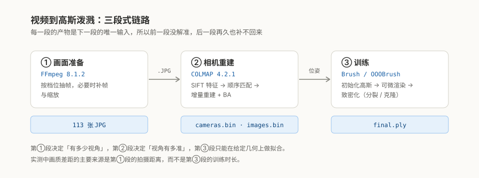

# OOOSplat 复刻记录

> 在一台 16 GB 的 Apple Silicon MacBook 上，把 [OOOSplat](https://github.com/ooolabdev/ooosplat) 从源码完整跑通，用四段真实素材走完「视频 → 高斯泼溅 → PLY」全链路，并对参数、耗时与画质做了定量记录。

本仓库是 OOOSplat 的 fork，fork 自上游 tag `0.8.1`。**所有新增内容都在 `replication/` 目录下**，上游文件除根目录新增一个 `run-dev.sh` 外未作任何修改——这样 `git pull upstream` 永远不会冲突，也能一眼看出哪些内容是复刻记录、哪些是原作者代码。



---

## 结论先行

| # | 素材 | 档位 | 抽帧 | 注册率 | 平均轨迹长度 | splat 数 | 耗时 | 结论 |
|---|---|---|---:|---:|---:|---:|---:|---|
| 1 | 544×960 / 14.1s | 均衡 | 113 | 74.3% | 7.01 | 166,123 | 7.7 min | 能出形状，细节全丢 |
| 2 | 4K / 22.1s | 均衡 | 177 | 79.1% | 7.41 | 292,999 | 33.6 min | **性价比最高的一档** |
| 3 | 4K / 22.1s | 精细 | 265 | 76.6% | 6.95 | 534,181 | 253.7 min | 7.55 倍时间换 1.82 倍高斯 |
| 4 | 4K / 38.4s | 均衡 | 307 | **100%** | **8.77** | 171,968 | 31.6 min | 注册率满分，画质反而更差 |

四个结果放在 `results/`，每张图左边是原始帧，右边是按**同一相机位姿**渲染的模型。

---

## 三个反直觉的发现

**① splat 数量度量的是场景信息量，不是算力投入。**

第 3 次比第 2 次多花 7.5 倍时间，splat 只涨 1.82 倍。因为致密化的触发条件是「某个高斯在自己的视角里糊了」——光滑曲面达不到梯度阈值，加分辨率只是把同一块光滑区域放大，不产生新的高频细节。

**② 注册率是整幅画面的指标，不是物体的指标。**

第 4 次拿到 307/307 全注册，画质却是四次里最差的。因为背景是一整面亮墙，纹理弱但面积大、帧间一致，COLMAP 匹配得很轻松；而手办只占画面高度 18%，物体上的有效像素比第 2 次少了 3.3 倍。

> 真正该看的指标是「**物体在画面里占多少像素**」，这个数肉眼就能估。

**③ 内存不足会把耗时放大数倍，且伪装成算法开销。**

第 3 次的特征提取耗时 56.9 分钟，按像素和帧数线性外推只该 8 分钟。多出来的部分是 swap 换页——同一时段机器只剩 100 MB 空闲内存、swap 用了 1.46 GB。

佐证：第 4 次同样的均衡档参数，内存宽松时训练速度 15.3 步/秒，第 2 次只有 8.3 步/秒，**快 1.8 倍**。

---

## 三步复现

**前置**：macOS 15+ / Apple Silicon、Node.js 22.12+、Rust stable、Xcode Command Line Tools。

以下命令**在仓库根目录执行**（源码已在仓库里，不需要另外克隆）。

```bash
# 1. 装前端依赖 + 从官方 dmg 提取四个引擎（约 470 MB 依赖 + 215 MB dmg）
./replication/tools/setup.sh

# 2. 启动应用（等价于根目录的 ./run-dev.sh）
./replication/tools/run-dev.sh

# 3. 或者直接用命令行跑一整条链路
./src-tauri/target/debug/splatstudio generate \
  ~/path/to/video.mp4 --quality balanced \
  --projects-root "$(pwd)/../splat-projects"
```

`--projects-root` 必须是**绝对路径**，且建议放在仓库外的同级目录，避免模型文件混进版本库。

细节见 [`docs/01-复现指南.md`](docs/01-复现指南.md)。**这一步有两个必踩的坑**，`setup.sh` 和 `run-dev.sh` 就是为了绕开它们而写的，原因写在 [`docs/04-踩坑记录.md`](docs/04-踩坑记录.md)。

---

## 目录

```
replication/            ← 本目录即全部新增内容，上游文件一行未改
  docs/
    01-复现指南.md      从零到跑通，含引擎提取与验签
    02-原理拆解.md      SfM → 相机位姿 → 高斯 → 泼溅，配四张示意图
    03-实测报告.md      四次运行的完整数据与归因分析
    04-踩坑记录.md      11 个坑，每条含现象 / 根因 / 解法

  tools/
    setup.sh            装前端依赖 + 从官方 dmg 提取四个引擎并验签
    run-dev.sh          绕过 prepareBrush 哈希校验的启动脚本
    preview_ply.py      按 COLMAP 真实位姿渲染 PLY（仅依赖 numpy + Pillow）
    collect_stats.py    从项目日志汇总指标成 CSV

  results/
    runs.csv            四次运行的原始指标
    run-0*.jpg          重建结果 vs 原始帧

  figures/
    01-pipeline.svg         三段式链路
    02-gaussian-anatomy.svg 59 个 float 怎么构成一个高斯
    03-sfm-stages.svg       SfM 四阶段
    04-split-geometry.svg   分裂与克隆的几何差异

run-dev.sh              ← 仓库根目录唯一的改动：转发到 replication/tools/run-dev.sh
```

---

## 与上游同步

本仓库是 fork，上游更新可以直接合进来，**不会冲突**——因为改动全部隔离在 `replication/` 和根目录一个 `run-dev.sh`。

```bash
git remote add upstream https://github.com/ooolabdev/ooosplat.git   # 只需一次
git fetch upstream
git merge upstream/main
```

唯一的潜在冲突是根目录 `run-dev.sh`，但上游没有这个文件，所以也不会撞。

如果想反过来把修复提给上游（比如 `run-dev.sh` 绕过的那个哈希校验问题），建议按上游的 `CONTRIBUTING.md` 单独开 PR，不要把这个 fork 的文档一起提过去。

---

## 这个仓库不包含什么

| 内容 | 原因 |
|---|---|
| COLMAP / FFmpeg / Brush 二进制 | 分别受 BSD-3-Clause 与 LGPL-2.1+ 约束，再分发需附带完整许可证与源码获取声明。上游仓库本身也通过 `.gitignore` 排除 `engines/`，改为从官方 dmg 提取 |
| `final.ply` 模型文件 | 单个 37–120 MB，超出 GitHub 单文件限制，且属于结果而非代码。README 与 `results/` 中给出指标，模型请按 `docs/01` 自行生成 |
| 原始视频素材 | 个人素材，无需公开。换用你自己的素材同样能跑通 |

---

## 引用与许可

**本仓库的原创内容**（`replication/` 下的 `tools/`、`docs/`、`figures/`、`results/`）以 **Apache-2.0** 授权，与上游一致，归属声明见 [`NOTICE-ADDITIONS.md`](NOTICE-ADDITIONS.md)。

**上游 OOOSplat 代码**保留其原有的 `LICENSE` 与 `NOTICE`，版权归 ooolabdev 所有。本仓库对其未作修改，因此不构成衍生作品声明。

运行时依赖的第三方项目**不随本仓库分发**，其许可与获取方式列于 `NOTICE-ADDITIONS.md`。

算法来源请引用：

```bibtex
@article{kerbl20233d,
  title   = {3D Gaussian Splatting for Real-Time Radiance Field Rendering},
  author  = {Kerbl, Bernhard and Kopanas, Georgios and Leimk{\"u}hler, Thomas and Drettakis, George},
  journal = {ACM Transactions on Graphics},
  volume  = {42},
  number  = {4},
  year    = {2023},
  doi     = {10.1145/3592433}
}
```

---

## 免责

`results/` 中的示例素材为作者个人拍摄的实体玩具，仅用于技术演示。所涉角色形象的著作权归原权利人所有，与本仓库无关。仓库中的分析结论仅针对上述四段素材，不代表 OOOSplat 或 3DGS 方法的性能上限。
