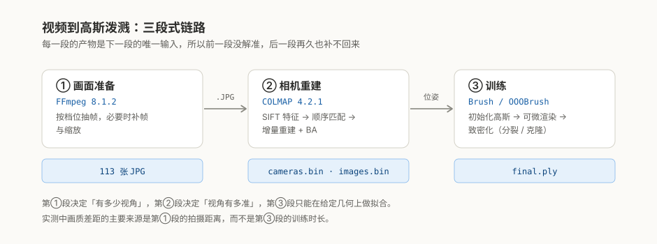
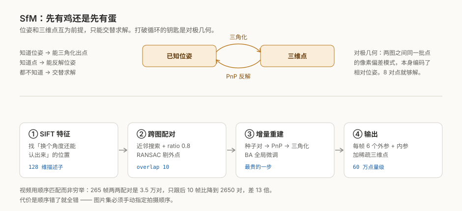
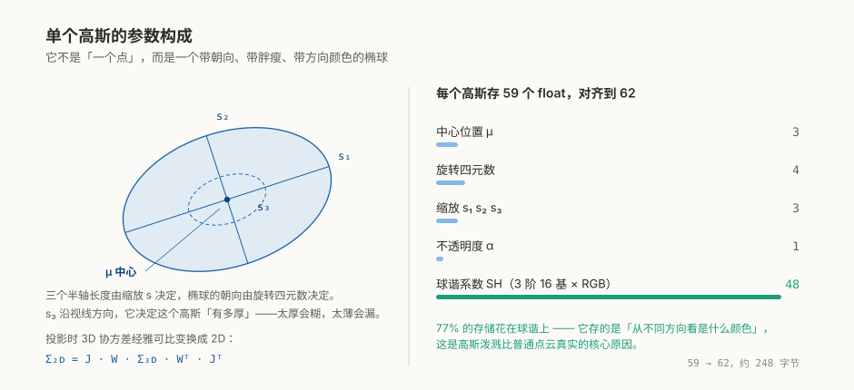
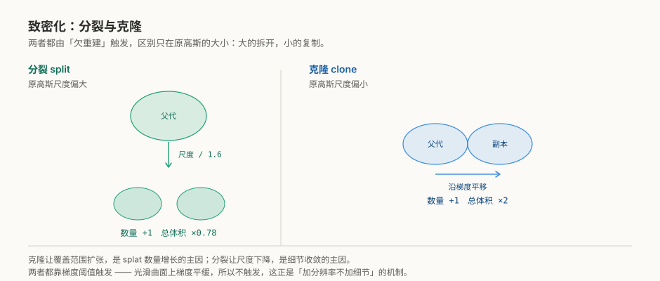

# 原理拆解：从视频到高斯泼溅

> 这篇不推导公式，只讲因果链：每一步为什么必须存在，跳过它会崩在哪。
> 读完之后，你应该能自己判断「我的素材为什么出不来」。

---

## 一句话

**三维不是从像素里算出来的，是从「同一批点在多张图里的位移」里解出来的。**

照片把三维压成二维时丢掉了深度。要捡回来只有一个办法：从不同位置看同一个东西，用位移反推。整条链路的所有复杂度，都来自「怎么把位移解准」。

---

## 一、全景：三段式链路



| 阶段 | 干什么 | 用什么 | 输入 → 输出 |
|---|---|---|---|
| ① 画面准备 | 把视频拆成帧，必要时补帧、缩放 | FFmpeg 8.1.2 | `.MOV` → N 张 JPG |
| ② 相机重建 | 解出每张图的拍摄位置和朝向 | COLMAP 4.2.1 | N 张 JPG → `cameras.bin` + `images.bin` + 稀疏点云 |
| ③ 训练 | 把点云长成可渲染的高斯 | Brush（OOOBrush） | 上面两者 → `final.ply` |

三段的产物是层层依赖的：**②没解准，③再久也救不回来**。这也是为什么「训练时间加倍」往往没用，而「拍摄距离退一半」立刻见效。

---

## 二、相机是怎么成像的

针孔模型把成像写成一行矩阵乘法：

```
x = K · [ R | t ] · X
```

- `X` 是世界坐标里的三维点，`x` 是它在照片上的像素坐标
- `K` 是**内参**：焦距、主点、畸变。**手机拍照会写进 EXIF**
- `[R | t]` 是**外参**：相机在哪、朝哪。**EXIF 里没有**

所以「把图片变成三维」这个看起来庞大的问题，可以化简成一句话：

> **把每张照片的外参解出来。**

内参已知、外参未知，这就是整个 SfM 要解决的东西。

---

## 三、为什么一张照片不够

一个三维点沿视线方向前后滑动时，在单张照片上的投影位置**完全不变**。所以单张图只能确定方向，不能确定距离——这是投影的固有退化，不是算法缺陷。

两张图就有两条视线，它们（理论上）只有一个交点，深度唯一了。这个过程叫**三角化**。

代价是：你得知道两台相机的相对位置。而这正是我们不知道的。

---

## 四、SfM：一个先有鸡还是先有蛋的问题

条件是循环的：

- 知道位姿 → 能三角化出三维点
- 知道三维点 → 能反解位姿（PnP）
- 两个都不知道 → **只能交替求解**

打破循环的钥匙是**对极几何**：两张图里同一批点的像素坐标之间的偏差模式，本身就编码了两台相机的相对位姿。理论上 8 对匹配点就够解出来。



### ① 找特征点（SIFT）

在每张图上找出「无论缩放、旋转、改亮度都能被再次认出」的位置。每个点用 128 维向量描述它周围的梯度分布。

关键指标是**可重复性**：同一个物理点，在两张不同距离、不同角度的照片里，要算出几乎相同的向量。这决定了后面能配对上多少。

> 这一条直接解释了为什么「弱纹理表面」拍不出来。白墙、纯色塑料、镜面，它们周围的梯度长得都一样，SIFT 提出的点在帧与帧之间对不上号。

### ② 跨图配对

描述子最近邻搜索，再用 **Lowe ratio test**（最近距离 / 次近距离 < 0.8）筛一遍——如果第一名和第二名一样近，说明这个点没有辨识度，丢掉。

然后用 **RANSAC** 剔外点：随机抽 8 对点算一个几何模型，统计有多少对符合它，重复几百次取支持者最多的。这样即使有 30% 的错配，也能解出正确模型。

**视频为什么不用穷举匹配？** 265 帧两两配对是 3.5 万对，而顺序匹配只需每帧跟后面 10 帧比较，降到 2650 对——**差 13 倍**。这就是 `--SequentialMatching.overlap 10` 的含义，也是视频重建比散图重建快得多的原因。

代价是：**顺序错了就全错**。图片集如果文件名顺序和拍摄顺序不一致，必须手动指定顺序，否则匹配窗口会跨越不相关的画面。

### ③ 增量重建

1. 挑一对「重叠够多、基线够长」的种子图（基线太短 → 三角化精度差；太长 → 匹配点太少）
2. 三角化出初始点云
3. 循环：找与当前模型共享匹配最多的未注册图 → PnP 求位姿 → 三角化新点 → **光束法平差（BA）** 微调 → 直到没有图能接进来

BA 是最贵的一步：把所有位姿和三维点放在一起，最小化「重投影误差」这个联合目标。**没有 BA，加到第 50 张图时误差就会累积到模型散架。**

这也是「注册率」这个指标的来源——`registered / frames`，即最终有多少张图成功接进了模型。

### ④ 输出

每张图的 6 个外参 + 内参，加一堆稀疏三维点。

**注意这一步的输出有多稀疏**：一次 307 帧的重建，稀疏点云通常只有几十万个点，且集中在纹理强的地方。它离「能看」还差得远——但它是唯一带有正确几何的东西。

---

## 五、从稀疏点到高斯

COLMAP 给的点没有形状、没有大小、没有颜色渐变。Brush 做的事是：

1. **初始化**：把每个稀疏点变成一个各向同性的高斯，尺度取它到最近邻点的距离
2. **训练**：用可微渲染把高斯泼溅到每个已知位姿的相机上，和原图比对，反向传播修正参数
3. **致密化**：在「梯度大」或「尺度过小」的地方分裂出新高斯，在「几乎透明」的地方删掉



每个高斯存 62 个 float：

| 参数 | 数量 | 作用 |
|---|---:|---|
| 中心位置 μ | 3 | 它在哪里 |
| 旋转四元数 | 4 | 椭球朝向 |
| 缩放 | 3 | 三个轴各多胖 |
| 不透明度 α | 1 | 有多「实」 |
| 球谐系数 | 48 | 从不同方向看是什么颜色（3 阶 16 基 × RGB） |

合计 3 + 4 + 3 + 1 + 48 = **59**，加上法线或填充字段对齐到 62（不同实现略有差异，`preview_ply.py` 里是按实际 PLY 头解析的，不写死）。

球谐系数是「视角相关颜色」的来源：同一块高光，正面看是白的，侧着看变暗——因为它不是固定颜色，而是**方向的函数**。这也是高斯泼溅比传统点云真实的核心原因。

渲染时，每个高斯的 3D 协方差通过投影雅可比 `J` 变成 2D 协方差：

```
Σ₂ᴅ = J · W · Σ₃ᴅ · Wᵀ · Jᵀ
```

再按深度排序、做 alpha 混合。`tools/preview_ply.py` 做的就是这件事——它不训练，只按 COLMAP 解出的真实位姿把 `final.ply` 泼溅回图像，用来和原片逐像素对比。

---

## 六、致密化为会在某处停下来

这是理解「为什么加分辨率没用」的关键。

致密化的触发条件大致是两条：

- **欠重建**：某个高斯在某个视角下的梯度超过阈值（说明它没能拟合这个视角的细节）
- **过重建**：某个高斯的尺度小于阈值（说明它碎成了不该有的小块）

光滑曲面（塑料、陶瓷、喷漆金属）的问题在于：**它本来就没有高频细节**。把它放大到 4K，梯度依然平缓，达不到触发阈值。于是加分辨率只是把同一块光滑区域渲染得更平滑，不产生新的高斯。

所以：

> **splat 数量度量的是「场景里有多少可学的细节」，不是「你投入了多少算力」。**

实测印证：精细档比均衡档多花 7.5 倍时间，splat 只涨 1.82 倍（29.3 万 → 53.4 万）。而换成一段「手办占画面更小」的素材，splat 直接掉到 17.2 万——**预算给了 135 万，只用了 13%**，因为没有那么多东西可学。



分裂（split）有严格的几何约束：两个新高斯的位置从原高斯的分布里采样，尺度除以 1.6。

于是总体覆盖降到原来的 **0.78**（2 / 1.6²）——这是刻意的收缩，防止致密化失控。克隆（clone）则沿梯度方向平移一份、尺度不变，总体覆盖直接**翻倍**。

由此可以推出一个不太直观的结论：

> **splat 数量的增长主要来自克隆，细节精度的提升主要来自分裂。**
>
> 克隆处理的是「小而欠重建」的高斯——它已经够细了，只是覆盖不够；分裂处理的是「大而欠重建」的高斯——它太粗，需要拆细。

这意味着致密化不是凭空创造表达能力，而是在**重分配**。没有细节的地方，它两边都做不了：梯度不够，不触发克隆；尺度不够大，不触发分裂。

---

## 七、把原理翻译成拍摄建议

| 原理 | 推论 |
|---|---|
| 外参靠帧间位移解出 | 必须有**平移**。原地转圈只有旋转，三角化退化成一条射线，解不出深度 |
| SIFT 需要梯度 | 避免白墙、纯色、镜面、强反光。要有纹理（木纹、布料、文字） |
| 顺序匹配依赖拍摄顺序 | 匀速、连续、不要跳帧回跳 |
| 精度取决于物体占多少像素 | **让物体占画面高度的一半以上**。这是最容易被忽略、影响最大的一条 |
| 浅景深背景的模糊逐帧不同 | 避免大光圈虚化背景，SIFT 会在虚化区提出位置飘忽的点，重建出一片麻点 |
| 致密化需要梯度触发 | 光滑物体不会因为分辨率提高而变细，想提升只能靠近拍、增加有效像素 |
| BA 依赖重叠 | 相邻帧重叠 60% 以上；转一圈要闭合回起点 |

---

## 八、一句话总结每段

- **抽帧**：把时间换成视角数量
- **SfM**：把视角之间的位移换成相机位置
- **三角化**：把两条视线换成深度
- **高斯**：把点换成带形状和方向的东西
- **训练**：把「渲染出来像不像」换成参数修正
- **致密化**：把拟合不好的地方换成更多高斯

每一步都在做同一件事：**把一种信息换成另一种信息**。任何一步的信息量不够，后面都补不回来。

---

## 参考

- Kerbl et al., *3D Gaussian Splatting for Real-Time Radiance Field Rendering*, ACM TOG 42(4), SIGGRAPH 2023. [arXiv:2308.04079](https://arxiv.org/abs/2308.04079)
- Schönberger & Frahm, *Structure-from-Motion Revisited*, CVPR 2016（COLMAP 的算法出处）
- Lowe, *Distinctive Image Features from Scale-Invariant Keypoints*, IJCV 2004（SIFT 原始论文）
